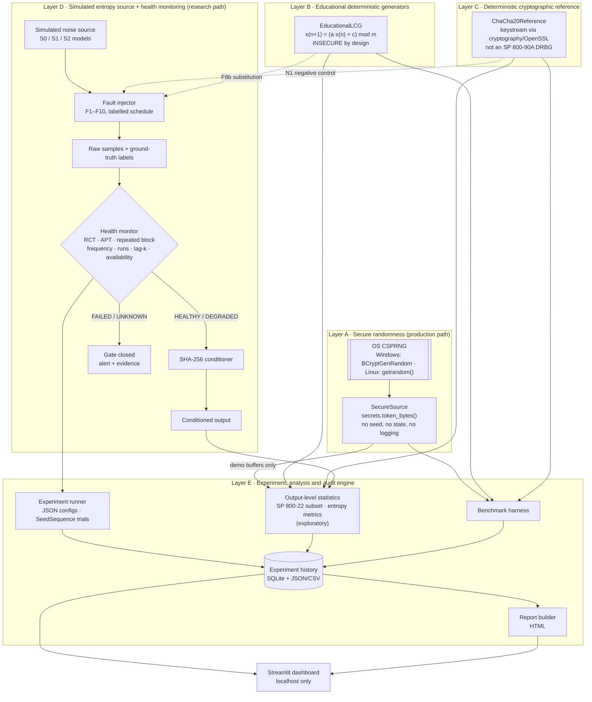

# Architecture

| | |
|---|---|
| Status | Phase 1 design, 2026-10-26; Phases 1–5 implemented (2026-10-27). Modules marked *(Phase 6)* or later do not exist yet. |
| Principle | Two strictly separated data paths: a **production path** that only ever returns OS CSPRNG bytes, and a **research path** that works on simulated sources and deterministic generators. Nothing on the research path can reach the production path. |

## 1. Layered architecture



Plain-text summary of the same structure:

```
 PRODUCTION PATH                     RESEARCH PATH
 ───────────────                     ─────────────
 OS CSPRNG                           Simulated source ──► Fault injector ──► raw samples (+labels)
    │                                                                         │
 SecureSource (secrets)                                               Health monitor (Layer D)
    │                                                                  │ HEALTHY        │ FAILED/UNKNOWN
    ▼                                                                  ▼                ▼
 caller (never logged,                                          SHA-256 conditioner   gate closed + alert
 never persisted)                                                      │
                                                                       ▼
 LCG (Layer B) ─┐                                               conditioned output
 ChaCha20 (C) ──┼──► statistics · benchmarks · experiment runner (Layer E) ──► SQLite/JSON ──► report, dashboard
 demo buffers ──┘
```

## 2. Layer responsibilities

| Layer | Module(s) | Responsibility | Must never |
|---|---|---|---|
| A | `security/secure_source.py` | Return bytes from `secrets.token_bytes`, which uses `os.urandom`; validate request sizes; map OS errors to a typed exception | Accept a seed; cache or log output; fall back to `random` |
| B | `security/educational_lcg.py` | Deterministic LCG with two documented presets (full-state 32-bit; 48-bit with top-32-bit output); Hull-Dobell period check; demo attacks: next-output prediction, (a, c) recovery from three outputs, truncated-state recovery from two outputs, clock-seed recovery | Be selectable anywhere security-sensitive output is needed |
| C | `security/crypto_reference.py` | ChaCha20 keystream through `cryptography` (256-bit key, 96-bit nonce, 32-bit counter). Key modes: `random` (from `SecureSource`, transparent rekey at the counter limit), `seeded` (key = SHA-256 of a recorded experiment seed), `explicit` (test vectors), `negative-control` (published key). Fixed-key modes raise before the counter limit. | Present itself as an SP 800-90A DRBG; retain, log or pickle keys; pass the counter limit |
| D | `monitoring/` *(Phase 3)* | Detectors with documented null models; thresholds from (α, H); fail-closed aggregation; alert evidence and limitation text | Report `HEALTHY` after an error or with insufficient data |
| D | `experiments/` *(Phase 3)* | Simulated sources, fault schedules, conditioning, trial runner, metrics | Touch the host OS RNG |
| E | `analysis/` *(Phase 4)*, `storage/` *(Phase 5)*, `reporting/` *(Phase 6)* | Statistics, intervals, benchmarks, persistence, reports | Persist secure-source output or keys; state that a hypothesis is proven |
| UI | `dashboard/` *(Phase 5)* | Eight pages; explanations; exports | Expose production output; bind to non-local interfaces by default |

## 3. Final directory structure

The structure follows the brief. Additions are marked **+** and justified in §4.

```
crypto/                              repository root (distribution name: entropylens)
├── pyproject.toml                   metadata, dependency ranges, ruff/pytest/mypy config
├── requirements.txt                 exact versions of the verified environment (lock)
├── README.md
├── LICENSE                          MIT
├── .gitignore
├── .streamlit/config.toml       +   dark theme; server bound to localhost        (Phase 5)
├── entropylens/
│   ├── __init__.py                  package version
│   ├── config.py                    Pydantic models for experiment configs; safe JSON loading
│   ├── cli.py                   +   list / run / benchmark / metadata commands
│   ├── __main__.py              +   `python -m entropylens` delegates to cli
│   ├── security/
│   │   ├── __init__.py
│   │   ├── base.py              +   ByteGenerator protocol, GeneratorInfo, request validation
│   │   ├── secure_source.py         Layer A
│   │   ├── educational_lcg.py       Layer B
│   │   └── crypto_reference.py      Layer C
│   ├── monitoring/
│   │   ├── __init__.py
│   │   ├── samples.py           +   sample kinds and input validation (shared, no upward imports)
│   │   ├── thresholds.py        +   (α, H) → cutoffs; exact null distributions
│   │   ├── detectors.py             RCT, APT, repeated block, frequency, runs, lag-k,
│   │   │                            autocorrelation and byte χ² (exploratory), availability
│   │   ├── source_health.py         MonitorSettings, build_detectors, HealthMonitor (gate, latching)
│   │   └── alerts.py                Alert, Outcome, SourceStatus, DetectorSpec
│   ├── experiments/
│   │   ├── __init__.py
│   │   ├── synthetic_sources.py     S0, S1, S2, S0-byte models (Markov-chain generator)
│   │   ├── fault_injection.py       F1–F10 specs, labels, outage events; N1 negative control
│   │   ├── conditioning.py      +   SHA-256 conditioner; pipelines P0, P2; P3 DRBG chain
│   │   ├── evaluation.py            CellSpec, trial runner, metrics, ablation, exposure
│   │   └── placement.py         +   E3: P1 output tests vs P2 vs P3 on identical traces
│   ├── analysis/
│   │   ├── __init__.py
│   │   ├── statistical_tests.py     SP 800-22 subset (exact longest-run classes), Holm/BH
│   │   ├── entropy_metrics.py       Shannon, pattern entropy, MCV min-entropy, compression
│   │   ├── intervals.py         +   Wilson, Clopper–Pearson, Newcombe, bootstrap
│   │   └── benchmark.py             generator and pipeline (H3) benchmarks, machine metadata
│   ├── storage/
│   │   ├── __init__.py
│   │   ├── schemas.py               versioned result-file schema
│   │   ├── repository.py            result files: safe JSON, confinement, digests
│   │   └── history.py           +   SQLite index: sync, integrity, filters, compare, CSV/JSON
│   ├── reporting/
│   │   ├── __init__.py
│   │   ├── report_builder.py        Markdown report (Phase 5); HTML export      (Phase 6)
│   │   └── templates/report.html.j2  +                                           (Phase 6)
│   └── dashboard/
│       ├── __init__.py
│       ├── app.py                   st.navigation entry point (three page groups)
│       ├── theme.py             +   reference dark palette, Plotly template, status badges
│       ├── components.py        +   alert cards, badges, limitation boxes, table views
│       ├── catalogue.py         +   selectable generators and what may be revealed
│       ├── controls.py          +   model, fault-scenario and monitor inputs
│       ├── simulation.py        +   Streamlit-free computation behind the pages
│       ├── plots.py             +   signal, repetition and status charts
│       ├── state.py             +   per-session state and history access
│       └── pages/                   overview, randomness_lab, health_monitor, fault_lab,
│                                    statistical_analysis, benchmarking, history, report
├── tests/
│   ├── conftest.py
│   ├── test_secure_source.py        (Phase 1)
│   ├── test_educational_lcg.py      test_crypto_reference.py   test_config.py          (Phase 2)
│   ├── test_thresholds.py           test_detectors.py          test_fault_injection.py
│   ├── test_synthetic_sources.py    test_source_health.py      test_evaluation.py
│   ├── test_intervals.py                                                               (Phase 3)
│   ├── test_statistics.py           test_entropy_metrics.py    test_benchmark.py
│   ├── test_placement.py            test_storage.py            test_cli.py             (Phase 4)
│   ├── conftest.py (CLI-built result files)   test_history.py   test_reporting.py
│   └── test_dashboard_smoke.py      (every page and main action, via Streamlit AppTest) (Phase 5)
├── experiments/
│   ├── configs/                     JSON experiment configurations (smoke now; E1–E7 later)
│   └── results/                     result JSON, SQLite history (generated; git-ignored)
└── docs/
    ├── proposal.md   architecture.md   threat_model.md   methodology.md   references.md   (Phase 1)
    ├── limitations.md                                                                   (Phase 6)
    ├── report.md                    full academic report with measured results           (Phase 7)
    └── demo_script.md               timed professor-facing walkthrough                   (Phase 7)
```

## 4. Justification of structural changes

| Addition | Reason |
|---|---|
| `security/base.py` | All generators share a `ByteGenerator` protocol and a `GeneratorInfo` record, so that benchmarks, statistics and the dashboard treat them uniformly. The record carries an explicit `security_status`, so an educational generator can never be mistaken for a production one. |
| `monitoring/thresholds.py` | Threshold derivations (RCT/APT cutoffs, exact binomial and transition-count tails, repeated-block sizing) are the scientifically sensitive part. Isolating them makes them unit-testable against SciPy independently of detector logic. |
| `experiments/conditioning.py` | The placement experiment (E3) needs explicit pipelines P0–P3. Conditioning belongs to the simulated pipeline, not to the monitor. |
| `analysis/intervals.py` | Interval estimation is used by evaluation, benchmarks and reporting. One implementation avoids divergent copies. Built in Phase 3 because the evaluation metrics need it. |
| `experiments/placement.py` | E3 needs every trial's identical trace examined three ways (P1, P2, P3). Keeping it separate stops `evaluation.py` from mixing raw-monitor metrics with output-test bookkeeping. |
| `storage/schemas.py`, `repository.py` (in Phase 4) | The CLI must write results as soon as experiments can run. The file format and its safety controls came first; the history index follows in Phase 5. |
| `monitoring/samples.py` | Sample kinds and input validation are shared by sources, detectors and the monitor. Keeping them in `monitoring` means `monitoring` never imports from `experiments`. The monitor accepts any object with the `NominalModel` protocol. |
| `cli.py`, `__main__.py` | Experiments must run headless and reproducibly, without the dashboard. |
| `dashboard/theme.py`, `components.py` | Shared visual language and the alert-explanation component, used by several pages. |
| `dashboard/simulation.py`, `controls.py`, `plots.py`, `catalogue.py`, `state.py` | The computation behind the pages is Streamlit-free and reuses the experiment code, so interactive results are computed exactly as reported ones. Inputs, charts, the "what may be revealed" policy and session state are each defined once. |
| `storage/history.py` (separate from `repository.py`) | The result files are the source of truth; the SQLite index is derived, rebuildable and safe to delete. Keeping them apart makes that relationship explicit. |
| `.streamlit/config.toml` | Dark theme and `server.address = "localhost"` as safe defaults. |
| No `utils.py` | Deliberately absent, to avoid a catch-all module. |

## 5. Key interfaces

Signatures are illustrative for unbuilt phases. `security/base.py` already exists in this form.

```python
# security/base.py  (implemented in Phase 1)
SecurityStatus = Literal["production", "educational-insecure", "reference-deterministic"]


@dataclass(frozen=True, slots=True)
class GeneratorInfo:
    identifier: str  # stable ID recorded in experiment metadata
    display_name: str
    security_status: SecurityStatus
    deterministic: bool
    backend: str  # human-readable description of the underlying mechanism


class ByteGenerator(Protocol):
    @property
    def info(self) -> GeneratorInfo: ...
    def generate(self, n_bytes: int) -> bytes: ...


# monitoring/detectors.py  (Phase 3, illustrative)
class Detector(Protocol):
    spec: DetectorSpec  # name, level, null model, alpha, threshold, derivation

    def update(self, samples: npt.NDArray[np.uint8], offset: int) -> list[DetectorEvent]: ...
    def reset(self) -> None: ...


# monitoring/source_health.py  (Phase 3, illustrative)
class HealthMonitor:
    def process(self, samples: npt.NDArray[np.uint8]) -> MonitorReport: ...  # status, events, gate
    def reset(self) -> None: ...  # explicit unlatch
```

## 6. Technology and dependency plan

Target: **Python ≥ 3.12**. Verified on CPython 3.13 for Windows 11. Ranges are declared in
`pyproject.toml`. `requirements.txt` pins the exact versions of the verified environment.

| Package | Purpose | Layer | Notes |
|---|---|---|---|
| Python standard library: `secrets`, `os`, `hashlib`, `sqlite3`, `json`, `tracemalloc`, `platform` | CSPRNG access, SHA-256, history storage, safe serialisation, metadata | A, D, E | No YAML or pickle; JSON only |
| `numpy` | Vectorised sample processing; PCG64 for simulation | D, E | Simulation PRNG only; never used for secrets |
| `scipy` | Exact binomial quantiles, special functions (erfc, gammaincc) for statistical tests | D, E | Established, peer-reviewed numerical library |
| `cryptography` | ChaCha20 keystream (OpenSSL backend) | C | Reputable, actively maintained. Lower bound only, so security releases are not blocked; the lock file pins the tested version. |
| `pydantic` | Validated configuration and result schemas | E | Safe parsing from JSON; no code execution |
| `jinja2` | HTML report templates | E | Autoescaping enabled |
| `plotly` | Charts in the dashboard and in reports | E, UI | Reports embed plotly.js inline for offline viewing |
| `psutil` | Process memory and CPU metadata on Windows and Linux | E | `resource` is not available on Windows |
| `streamlit` *(extra: `dashboard`)* | Dashboard | UI | Bound to localhost |
| `pandas` *(extra: `dashboard`)* | Tables and CSV in the UI | UI | Also a Streamlit dependency |
| `pytest`, `pytest-cov`, `ruff`, `mypy` *(extra: `dev`)* | Tests, coverage, lint and format, type checking | — | |

**PDF export:** the HTML report uses print-friendly CSS, so "Save as PDF" in a browser works without
extra native dependencies. A native PDF engine (WeasyPrint needs GTK on Windows) is not planned
unless the HTML route proves insufficient.

**NIST SP 800-22:** a documented subset is implemented in `analysis/statistical_tests.py` instead of
adding a third-party SP 800-22 package. Each test is checked against independently recomputed
values, because the published worked examples contain errors [Riesinger-2025]. The verification
and the discrepancies found are in [methodology.md §9.1](methodology.md#91-output-level-tests-verification-of-the-implementation).

## 7. Security controls built into the code

| Control | Where |
|---|---|
| Single production entry point (`SecureSource.generate`) with no seed parameter | `security/secure_source.py` |
| Static test: the `security` package never imports `random` | `tests/test_secure_source.py` |
| Request-size caps and strict integer validation (booleans rejected) | `security/base.py` |
| `GeneratorInfo.security_status` shown on every UI surface that displays generator output | `security/base.py`, dashboard |
| Fail-closed status semantics with latching | `monitoring/source_health.py` |
| Keys excluded from `repr`, logs and result files | `security/crypto_reference.py`, `storage/schemas.py` |
| JSON-only configuration with Pydantic validation; no `eval`, `pickle` or `yaml.load` | `config.py`, `storage/` |
| File paths confined to `experiments/` subdirectories, resolved and checked | `storage/repository.py` |
| Dashboard bound to localhost; no uploads of executable content | `.streamlit/config.toml`, dashboard |
